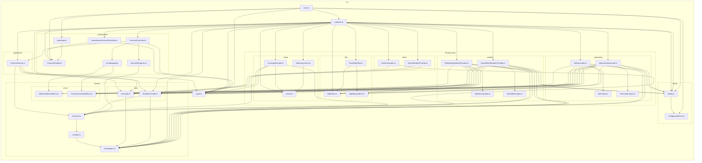

# TP Gestion des dépendances — API de prévisions météo par adresse

API HTTP qui, à partir d'une adresse, géocode le lieu (Nominatim) puis récupère les
prévisions de rayonnement solaire horaire (Open-Meteo).

`GET /forecast?address=<adresse>` :

```json
{
  "address": "Alès",
  "latitude": 44.1279,
  "longitude": 4.0817,
  "hourly": [
    { "time": "2025-06-10T14:00:00Z", "temperatureCelsius": 24.3 }
  ]
}
```

> Format **unifié au TP3** : cette structure est identique quel que soit le fournisseur
> actif (Nominatim/BAN, Open-Meteo/MET Norway) ou le mode démo — seul le contenu change.
> Le domaine reste plus riche (rayonnement, vent, fuseau, unités) ; seule la projection
> HTTP ([forecastResponse.ts](src/presentation/forecastResponse.ts)) fixe le contrat public.
> Voir la section [TP3](#tp3--mode-démo-cache-et-format-unifié).

Ce dépôt est un TP d'architecture logicielle : l'objectif pédagogique est la gestion
propre des dépendances (ports/adapters, injection de dépendances via IoC, composition
root unique), pas la fonctionnalité elle-même.

## Lancement

```bash
npm install
cp .env.example .env   # ajuster si besoin (voir tableau des variables ci-dessous)
npm run dev             # serveur de dev (tsx watch), ou :
npm run build && npm start
```

Le serveur écoute par défaut sur `http://localhost:3000`.

### Exemples de requêtes

> **Sous Windows PowerShell**, `curl` est un alias vers `Invoke-WebRequest`. Deux
> pièges : (1) il lève une exception sur les réponses non-2xx (400/404/502) et
> demande confirmation avant de parser le corps ; (2) même sur un 200, il affiche un
> **résumé tronqué** (`StatusCode`, `Content` coupé, ...) au lieu du corps JSON — les
> données sont bien là, juste pas affichées en entier. Ce n'est pas un bug de l'API.
> Pour voir la réponse complète, utilisez `curl.exe` (le vrai binaire curl) ou
> `Invoke-RestMethod` (parse directement le JSON) :
> ```powershell
> curl.exe "http://localhost:3000/forecast?address=Lyon"
> # ou
> Invoke-RestMethod "http://localhost:3000/forecast?address=Lyon" | ConvertTo-Json -Depth 5
> ```
> Bash (WSL, Git Bash, macOS, Linux) n'est pas concerné par ces deux pièges.

```bash
curl "http://localhost:3000/forecast?address=Al%C3%A8s"
# 200 -> { "address": "Alès", "latitude": 44.1279, "longitude": 4.0817,
#          "hourly": [ { "time": "2025-06-10T14:00:00Z", "temperatureCelsius": 24.3 }, ... ] }

curl "http://localhost:3000/forecast"
# 400 -> { "error": "Query parameter 'address' is required and must not be empty" }

curl "http://localhost:3000/forecast?address=xyzzy-adresse-inexistante"
# 404 -> { "error": "Address not found: xyzzy-adresse-inexistante" }

# Si Nominatim ou Open-Meteo est indisponible / timeout / répond un format invalide :
# 502 -> { "error": "The address geocoding or weather forecast provider is currently unavailable" }
```

```powershell
# Equivalent PowerShell (curl.exe = vrai binaire curl, contourne l'alias Invoke-WebRequest)
curl.exe "http://localhost:3000/forecast?address=Al%C3%A8s"
curl.exe "http://localhost:3000/forecast"
curl.exe "http://localhost:3000/forecast?address=xyzzy-adresse-inexistante"
```

### Scripts npm

| Script | Effet |
|---|---|
| `npm run dev` | Démarre le serveur en mode watch (`tsx`) |
| `npm run build` | Compile TypeScript vers `dist/` |
| `npm start` | Démarre le serveur compilé (`dist/main.js`) |
| `npm test` | Tests unitaires (`tests/unit`, aucun accès réseau) |
| `npm run test:contracts` | Tests de contrat par port (`tests/contracts`, un jeu d'assertions par fournisseur) |
| `npm run test:e2e` | Tests bout-en-bout (`tests/e2e`, supertest + msw, aucun accès réseau) |
| `npm run test:smoke` | Test optionnel contre les vraies API (désactivé sauf `RUN_SMOKE_TESTS=1`) |
| `npm run lint` | ESLint |
| `npm run arch` | Vérifie les règles de dépendances entre couches (`dependency-cruiser`) |
| `npm run arch:graph` | Régénère `docs/dependency-graph.mmd` (graphe Mermaid du README) |
| `npm run audit` | `npm audit` |
| `npm run verify` | Enchaîne lint + build + arch + tous les tests (hors smoke) |

## Architecture en couches

Les dépendances de code ne pointent que vers l'intérieur : `presentation` et
`infrastructure` dépendent de `application`/`domain`, jamais l'inverse. `domain` ne
dépend de rien (pas d'Express, pas de lib HTTP). `container.ts` est le **seul**
endroit qui connaît les implémentations concrètes (Nominatim, Open-Meteo, Express,
fetch).

> Graphe **généré automatiquement** par `dependency-cruiser` (`npm run arch:graph`),
> à partir du code réel — pas dessiné à la main. Il ne peut donc pas dériver de
> l'implémentation : s'il change, c'est que le code a changé. Voir la section
> [Étape 5 — dependency-cruiser](#étape-5--verification-automatique-des-frontières-dependency-cruiser)
> pour la vérification des règles qui le rendent fiable.



On y lit directement les invariants vérifiés par `dependency-cruiser` : `domain/` ne pointe que vers lui-même ; `application/` ne pointe que vers `domain/` et `types.ts` ; `presentation/` ne pointe jamais vers `infrastructure/` ; et `container.ts` est le seul nœud hors `infrastructure/` à pointer vers un adapter concret (`BanGeocoder`, `NominatimGeocoder`, `MetNorwayWeatherProvider`, `OpenMeteoWeatherProvider`, `FetchHttpClient`, et depuis le TP3 `CachingGeocoder`, `InMemoryCache`, `DemoGeocoder`, `DemoWeatherProvider`).

**Ajouter un nouveau fournisseur** (ex. un autre géocodeur) = une nouvelle classe
`implements Geocoder` dans `infrastructure/`, + une ligne de binding dans
`container.ts`. Zéro modification de `domain/` ou `application/`.

**Point d'extension** (cache : *implémenté au TP3*, voir plus bas ; retry et circuit
breaker : toujours hors scope, sur-ingénierie pour ce TP). Le point d'extension naturel est un
**décorateur de `Geocoder`** (ex. `CachingGeocoder implements Geocoder` qui enveloppe
`NominatimGeocoder` et court-circuite les adresses déjà résolues) branché d'une seule
ligne dans `container.ts` — cohérent avec le rate limit Nominatim (~1 req/s).

## Tableau d'inventaire des dépendances

| Dépendance | Interne / Externe | Directe / Transitive | Explicite / Implicite | Couplage | Risque |
|---|---|---|---|---|---|
| `express` | Externe | Directe | Explicite | Faible (isolé dans `presentation/createApp.ts`) | Faible — mature, très utilisé |
| `inversify` | Externe | Directe | Explicite | Moyen (décorateurs `@injectable`/`@inject` dans application/infra/presentation) | Faible/Moyen — API stable mais structurante |
| `reflect-metadata` | Externe | Directe | Explicite (import à effet de bord) | Faible mais global (requis avant tout usage de décorateurs) | Faible |
| `typescript` | Externe | Directe (dev) | Explicite | Fort (compile-time, tout le repo) | Faible — outil mûr |
| `vitest` (+ `vite`, `esbuild`, `@vitest/mocker` transitifs) | Externe | Directe (vitest) / Transitive (vite, esbuild) | Explicite (vitest) / Implicite (transitifs) | Faible (tests uniquement) | **Moyen** — vulnérabilités connues dev-only, voir `npm audit` ci-dessous |
| `supertest` | Externe | Directe (dev) | Explicite | Faible (tests e2e uniquement) | Faible |
| `msw` | Externe | Directe (dev) | Explicite | Faible (tests uniquement) | Faible/Moyen — écosystème plus jeune que nock, mais seul à supporter `fetch` natif de façon stable (voir note ci-dessous) |
| `eslint` / `typescript-eslint` | Externe | Directe (dev) | Explicite | Faible | Faible |
| `tsx` | Externe | Directe (dev) | Explicite | Faible (dev server uniquement) | Faible |
| `dependency-cruiser` *(TP2)* | Externe | Directe (dev) | Explicite | Faible (analyse statique, n'entre jamais dans `dist/`) | Faible |
| **API Nominatim** (`nominatim.openstreetmap.org`) | Externe (service, pas un paquet) | Directe (`NominatimGeocoder`) | Explicite dans le code, **implicite** dans son contrat (pas de SLA) | Fort si sélectionné — en tête de chaîne, bloquant pour toute la fonctionnalité | **Fort — SPOF potentiel** (voir section dédiée) |
| **API Open-Meteo** (`api.open-meteo.com`) | Externe (service) | Directe (`OpenMeteoWeatherProvider`) | Explicite dans le code, implicite dans son contrat | Moyen — isolé derrière un adapter, mais bloquant en aval si sélectionné | Moyen — gratuit, sans SLA formel, mais historiquement permissif |
| **API BAN** (`api-adresse.data.gouv.fr`) *(TP2)* | Externe (service public français) | Directe (`BanGeocoder`) | Explicite dans le code, implicite dans son contrat | Fort si sélectionné — même position en tête de chaîne que Nominatim | **Fort si sélectionné** — en plus : **souveraineté** (couverture France uniquement ; inutilisable tel quel pour géocoder une adresse hors de France, contrairement à Nominatim qui est mondial) |
| **API MET Norway** (`api.met.no`) *(TP2)* | Externe (service public norvégien) | Directe (`MetNorwayWeatherProvider`) | Explicite dans le code, implicite dans son contrat | Moyen si sélectionné — isolé derrière un adapter | Moyen/Fort — **User-Agent obligatoire non générique** (403 sinon, contrôlé au démarrage par `ConfigurationError`), conditions d'usage et quotas propres à MET Norway (service d'un institut météorologique national, pas un fournisseur commercial avec SLA) |
| Variables d'environnement (`PORT`, `*_BASE_URL`, `NOMINATIM_USER_AGENT`, `OPEN_METEO_USER_AGENT`, `HTTP_TIMEOUT_MS`, `OPEN_METEO_TIMEZONE`, `GEOCODER_PROVIDER`, `WEATHER_PROVIDER`, `MET_NORWAY_USER_AGENT`) | Interne au process | Directe (lues uniquement dans `config/Config.ts`) | **Implicite** (rien ne force leur présence, sauf `MET_NORWAY_USER_AGENT` validé au démarrage si `met-norway` selectionné) | Faible (valeurs par défaut sûres pour tout sauf le choix de fournisseur) | Faible — documenté dans `.env.example`, validation explicite (`ConfigurationError`) |
| User-Agent Nominatim / MET Norway | — (politique d'usage externe) | Directe | **Implicite** (pas une erreur HTTP formelle, juste une politique d'usage) | Faible techniquement, **fort en pratique** | Moyen — un User-Agent absent/générique peut faire bannir l'IP (Nominatim) ou renvoyer 403 (MET Norway) silencieusement pour le premier ; contrôlé au démarrage pour le second |
| Format des réponses JSON externes (Nominatim, Open-Meteo, BAN, MET Norway) | — (contrat non versionné) | Directe | **Implicite** (pas de schéma/OpenAPI garanti) | Fort — tout le mapping anti-corruption en dépend | Moyen — mitigé : réponse malformée → `ProviderUnavailableError` (502) plutôt qu'un crash |
| Rate limit Nominatim (~1 req/s, usage policy) | — | Directe (appelée à chaque requête entrante) | **Implicite** (non enforced côté code) | Fort si trafic élevé | Fort — cf. SPOF |
| Fuseau horaire / unités Open-Meteo (`timezone`, `hourly_units`) | — (contrat non versionné) | Directe (mappés dans `OpenMeteoWeatherProvider`, fuseau demandé via `OPEN_METEO_TIMEZONE`, défaut `"auto"`) | **Implicite** (Open-Meteo peut changer les libellés d'unité, ex. `"W/m²"`, sans préavis contractuel) | Moyen — consommé uniquement en presentation pour l'affichage, n'impacte pas la logique métier | Faible/Moyen — mitigé comme le reste du format JSON externe : absence de `timezone`/`hourly_units` → `ProviderUnavailableError` (502) plutôt qu'une valeur silencieusement fausse |
| Node.js runtime (`fetch`/`AbortController` natifs, ESM) | Externe | Directe | Implicite (version LTS attendue) | Fort (toute l'app) | Faible |

## SPOF et dépendance la plus risquée

**SPOF : l'API Nominatim.** Elle est en tête de chaîne (`ForecastService` appelle
toujours `geocode()` avant `getHourlyForecast()`) : si Nominatim est indisponible,
lent, ou rate-limite l'appel, **aucune** prévision ne peut être produite, même si
Open-Meteo fonctionne parfaitement. C'est un service communautaire gratuit sans SLA
contractuel, avec une politique d'usage stricte (~1 req/s, User-Agent obligatoire) qui
peut se traduire par un bannissement d'IP silencieux en cas de non-respect.

**Stratégie envisagée (non implémentée, hors scope du TP)** :
- Isoler ce risque derrière le point d'extension déjà prévu (décorateur `Geocoder`) :
  un `CachingGeocoder` réduirait la pression sur Nominatim pour les adresses
  répétées, et un futur `RetryingGeocoder`/`FallbackGeocoder` (ex. bascule vers un
  second fournisseur de géocodage) absorberait les indisponibilités ponctuelles.
- Le `HttpTimeoutMs` configurable évite déjà qu'une requête bloquée ne bloque
  indéfiniment l'API — c'est le seul filet de sécurité actuellement en place.
- À plus long terme : contractualiser (self-host Nominatim, ou un fournisseur
  commercial avec SLA) si le volume de requêtes dépasse ce que le service public
  tolère.

**Nouveau SPOF potentiel introduit par le TP2 : le choix de fournisseur en production.**
Depuis l'étape 3, `GEOCODER_PROVIDER`/`WEATHER_PROVIDER` peuvent pointer vers n'importe
laquelle des 4 API (Nominatim, BAN, Open-Meteo, MET Norway) — mais si le déploiement en
production **fige** ce choix sur un seul couple (ex. `nominatim`/`open-meteo` partout,
tout le temps), on a simplement déplacé le SPOF sans le réduire : c'est toujours une
seule API externe qui bloque toute la chaîne si elle tombe. Le côté configurable ne
*mitige* ce risque que si quelque chose exploite réellement cette configurabilité —
aujourd'hui rien ne le fait automatiquement (pas de bascule automatique, pas de
fallback). Actuellement le risque est donc **mitigé en théorie** (le point d'extension
existe, changer de fournisseur ne coûte qu'une variable d'env) mais **pas en pratique**
(personne ne bascule tant qu'un humain n'a pas décidé de changer la config et redémarré
le service).

Open-Meteo est la deuxième dépendance la plus risquée (même schéma de risque, mais
moins critique : historiquement plus permissif, pas de contrainte 1 req/s documentée).

## npm audit

```
$ npm audit
# npm audit report

@vitest/mocker  <=4.1.10
Severity: moderate
Vitest: Path Traversal / Arbitrary File Read via @vitest/mocker Redirect Mock - https://github.com/advisories/GHSA-82fw-gwwq-j7x9
Depends on vulnerable versions of vite
fix available via `npm audit fix --force`
Will install vitest@5.0.1, which is a breaking change
node_modules/@vitest/mocker
  vitest  <=4.1.10
  Depends on vulnerable versions of @vitest/mocker
  Depends on vulnerable versions of vite
  Depends on vulnerable versions of vite-node
  node_modules/vitest

esbuild  <=0.24.2
Severity: moderate
esbuild enables any website to send any requests to the development server and read the response - https://github.com/advisories/GHSA-67mh-4wv8-2f99
fix available via `npm audit fix --force`
Will install vitest@5.0.1, which is a breaking change
node_modules/vite/node_modules/esbuild
  vite  <=6.4.2
  Depends on vulnerable versions of esbuild
  node_modules/vite
    vite-node  <=2.2.0-beta.2
    Depends on vulnerable versions of vite
    node_modules/vite-node

5 vulnerabilities (3 moderate, 1 high, 1 critical)
```

**Analyse** : les 5 vulnérabilités restantes sont toutes internes à la chaîne
`vitest → vite → esbuild`, un outil de **développement/test uniquement**, jamais
présent dans `dist/` ni dans les dépendances de production (`express`, `inversify`,
`reflect-metadata`). Le risque décrit (un site web qui interroge le serveur de dev
esbuild) ne s'applique pas ici puisqu'aucun serveur de dev esbuild n'est exposé — la
CI/exécution des tests ne l'expose jamais publiquement. Le correctif nécessite un
passage à `vitest@5` (changement majeur, non trivial sur ce TP) ; accepté comme
risque résiduel documenté plutôt que traité en urgence.

## npm ls --depth=0

```
$ npm ls --depth=0
tp-gestion-dependances@1.0.0
+-- @eslint/js@9.39.5
+-- @types/express@4.17.21
+-- @types/node@22.10.10
+-- @types/supertest@6.0.2
+-- dependency-cruiser@18.3.1
+-- eslint@9.39.5
+-- express@4.22.3
+-- inversify@6.2.2
+-- msw@2.15.0
+-- reflect-metadata@0.2.2
+-- supertest@7.1.3
+-- tsx@4.23.13
+-- typescript-eslint@8.21.0
+-- typescript@5.7.3
`-- vitest@2.1.9
```

*(`dependency-cruiser` ajouté au TP2, étape 5 — voir la section TP2 pour son rôle.)*

## Notes techniques

- **Pourquoi `msw` plutôt que `nock`** (le sujet autorisait les deux) : l'adapter
  `FetchHttpClient` utilise le `fetch` natif de Node (basé sur `undici`). `nock`
  n'intercepte que le module `http` historique — son support de `fetch`/`undici` est
  encore expérimental (`nock@beta` uniquement), ce qui a été vérifié empiriquement
  avant de choisir `msw`, qui l'intercepte nativement et de façon stable.
- **Timeout HTTP** : `FetchHttpClient` utilise `AbortController` ; le délai est
  configurable via `HTTP_TIMEOUT_MS` (config, jamais lu ailleurs que dans
  `config/Config.ts`).
- Aucun `new` de service/adapter en dehors de `container.ts` (hors tests, où des
  fakes écrits à la main implémentent directement les ports du domaine).

## TP2 — Changement d'API

Le TP1 a posé l'architecture (ports/adapters, IoC/DI). Le TP2 met cette architecture à
l'épreuve : peut-on ajouter un **deuxième géocodeur** et un **deuxième fournisseur
météo**, sélectionnables par configuration, en modifiant le moins de code existant
possible ? L'état final du TP1 est figé par le tag Git `tp1` ; tous les commits du TP2
sont préfixés `TP2:`.

**Objectif** : démontrer que le coût d'ajout d'un fournisseur est bien celui annoncé au
TP1 ("une classe + une ligne dans `container.ts`"), ou documenter honnêtement où cette
promesse ne tient pas.

**Nouveaux fournisseurs à intégrer** :
- Géocodage : [BAN](https://api-adresse.data.gouv.fr/) (Base Adresse Nationale,
  France uniquement), à côté de Nominatim.
- Météo : [MET Norway](https://api.met.no/) (locationforecast/2.0/compact), à côté
  d'Open-Meteo — MET Norway ne fournit pas le rayonnement solaire, ce qui oblige à
  vérifier que le modèle de domaine ne suppose pas qu'un champ météo est toujours
  présent.

**Plan** :
1. Audit : repérer les formats/noms propres à Nominatim ou Open-Meteo qui auraient
   fui hors de `infrastructure/` (validé avant tout code).
2. Nouveaux adapters `BanGeocoder` et `MetNorwayWeatherProvider`, derrière les ports
   existants du domaine.
3. Sélection du fournisseur par variables d'environnement, résolue uniquement dans
   `container.ts`.
4. Tests de contrat : un seul jeu d'assertions par port, exécuté contre chaque
   implémentation (Nominatim/BAN, Open-Meteo/MET Norway).
5. Vérification automatisée des règles de dépendances (`dependency-cruiser`) pour
   garantir qu'aucun DTO d'adapter ne fuit hors de son fichier.
6. Bilan chiffré (`git diff --stat tp1..HEAD`) : fichiers ajoutés vs modifiés, et
   raison de chaque modification.

Le détail de chaque étape est documenté au fur et à mesure ci-dessous, au fil des
commits `TP2:`.

### Modèle de domaine neutre (étape 1-2)

L'audit a montré que le domaine du TP1 portait en fait le format Open-Meteo
(`shortwaveRadiation` obligatoire, tableaux parallèles `time[]`/`valeurs[]` + objet
`hourly_units` séparé — calqué sur la structure JSON exacte d'Open-Meteo). Impossible
pour MET Norway, qui ne fournit pas le rayonnement solaire.

Nouveau modèle : une série de **points horodatés**, chaque mesure étant **optionnelle**
et portant sa propre unité, au lieu de tableaux parallèles à côté d'un objet d'unités :

```ts
interface WeatherMeasurement { value: number; unit: string; }
interface HourlyPoint {
  time: string;
  temperature?: WeatherMeasurement;
  shortwaveRadiation?: WeatherMeasurement;
  windSpeed?: WeatherMeasurement;
}
```

Chaque provider ne remplit que ce qu'il sait mesurer (Open-Meteo → `shortwaveRadiation`
uniquement ; MET Norway → `temperature`/`windSpeed` uniquement, jamais
`shortwaveRadiation`). La réponse HTTP est maintenant un mapping direct de ce modèle
(plus aucune trace de `shortwave_radiation`/`hourly_units` dans `presentation/`).

### ADR — Erreur BAN pour une requête trop courte

**Contexte** : la BAN répond HTTP 400 (pas un tableau vide) quand la requête fait moins
de 3 caractères.

**Décision** : `BanGeocoder` traduit ce 400 en `AddressNotFoundError`, la même erreur
domaine qu'un résultat vide — pas de nouveau type d'erreur dédié à cette contrainte.

**Justification** : "la requête est trop courte pour être géocodée" reste, du point de
vue de l'appelant, un cas de "cette adresse n'a pas pu être résolue". Créer une erreur
domaine spécifique à une contrainte syntaxique propre à *un seul* fournisseur (Nominatim
n'a pas cette limite) aurait été une fuite d'abstraction à l'envers : le domaine se
mettrait à connaître un détail d'implémentation d'un adapter particulier. C'est un choix
assumé, pas un oubli — `ProviderUnavailableError` reste réservé aux vraies pannes
(timeout, HTTP 5xx, réponse malformée).

### ADR — Série météo vide traitée comme une panne, pas comme une prévision vide

**Contexte** : que faire quand un fournisseur météo répond avec succès (HTTP 200) mais
une série temporelle structurellement vide (`hourly.time: []`) ?

**Décision** : `ProviderUnavailableError`, pas un `WeatherForecast` avec `hourly: []`.
Comportement identique pour `OpenMeteoWeatherProvider` et `MetNorwayWeatherProvider`.

**Justification** : pour ce domaine (prévisions horaires sur plusieurs jours, couverture
mondiale des deux API), une série vide pour des coordonnées valides n'est jamais un état
métier légitime — elle signale une anomalie (coordonnées hors couverture, dégradation du
provider). Traiter ce cas comme une erreur plutôt qu'une prévision vide garde un
invariant simple pour toute la chaîne en aval (`Forecast` réussi ⇒ toujours exploitable)
et évite une incohérence entre les deux implémentations du port `WeatherProvider`.
Compromis assumé : si un provider avait un jour une raison légitime de renvoyer "aucune
donnée pour cette zone" sans panne, cette distinction serait perdue — non rencontré en
pratique sur ces deux API.

### Étape 5 — vérification automatique des frontières (dependency-cruiser)

Les étapes précédentes vérifiaient l'absence de fuite "à la lecture" (audit manuel,
tests de contrat). L'étape 5 rend cette garantie **vérifiable automatiquement** :
`dependency-cruiser` (`.dependency-cruiser.cjs`) analyse le graphe d'imports réel de
`src/` et `tests/` et échoue si une des règles suivantes est violée :

| Règle | Ce qu'elle empêche |
|---|---|
| `domain-purity` | `domain/` important autre chose que `domain/` (même une lib npm) |
| `application-purity` | `application/` important `infrastructure/`/`presentation/` ou une lib HTTP |
| `presentation-purity` | `presentation/` important `infrastructure/` directement |
| `no-concrete-adapter-outside-container` | N'importe quel fichier de `src/` (hors `infrastructure/` et `container.ts`) qui importerait un adapter concret (`NominatimGeocoder`, `BanGeocoder`, `OpenMeteoWeatherProvider`, `MetNorwayWeatherProvider`, `FetchHttpClient`) |
| `nominatim-dto-private`, `ban-dto-private`, `open-meteo-dto-private`, `met-norway-dto-private` | N'importe quel fichier (y compris les tests de contrat) qui importerait le DTO privé d'un adapter autre que le sien |

`npm run arch` lance la vérification (`src` + `tests`, pour que la règle sur les DTO
couvre aussi les tests de contrat) ; `npm run arch:graph` régénère le graphe Mermaid
ci-dessus. Premier passage sur le code existant : **0 violation** — confirmé aussi en
vérifiant que les règles mordent bien (import volontairement fautif ajouté puis retiré,
voir historique de commit de cette étape).

## TP2 — Bilan

Comparaison factuelle entre l'état final du TP1 (tag Git `tp1`) et l'état final du TP2
(`HEAD`) : `git diff --stat tp1..HEAD` → **33 fichiers changés, +2146/-148 lignes**.
Détail ci-dessous, classé par nature du changement.

### Fichiers AJOUTÉS (14)

| Fichier | Lignes | Contenu |
|---|---|---|
| `src/config/ConfigurationError.ts` | +6 | Erreur dédiée à une config invalide (étape 3) |
| `src/infrastructure/geocoding/BanGeocoder.ts` | +64 | Adapter BAN (étape 2) |
| `src/infrastructure/geocoding/BanTypes.ts` | +9 | DTO privé à BanGeocoder (étape 2) |
| `src/infrastructure/weather/MetNorwayTypes.ts` | +27 | DTO privé à MetNorwayWeatherProvider (étape 2) |
| `src/infrastructure/weather/MetNorwayWeatherProvider.ts` | +82 | Adapter MET Norway (étape 2) |
| `tests/unit/container.test.ts` | +75 | Tests bootstrap : sélection de fournisseur, config invalide (étape 3) |
| `tests/contracts/geocoder.contract.ts` | +61 | Fonction de contrat partagée `runGeocoderContract` (étape 4) |
| `tests/contracts/weather-provider.contract.ts` | +102 | Fonction de contrat partagée `runWeatherProviderContract` (étape 4) |
| `tests/contracts/geocoder.nominatim.contract.test.ts` | +55 | Fixtures Nominatim pour le contrat (étape 4) |
| `tests/contracts/geocoder.ban.contract.test.ts` | +74 | Fixtures BAN + cas spécifique "< 3 caractères" (étape 4) |
| `tests/contracts/weather-provider.open-meteo.contract.test.ts` | +74 | Fixtures Open-Meteo pour le contrat (étape 4) |
| `tests/contracts/weather-provider.met-norway.contract.test.ts` | +80 | Fixtures MET Norway pour le contrat (étape 4) |
| `.dependency-cruiser.cjs` | +120 | Règles anti-fuite (étape 5) |
| `docs/dependency-graph.mmd` | +124 | Graphe généré, source du Mermaid du README (étape 5) |

### Fichiers MODIFIÉS (19), avec la raison de chaque modification

| Fichier | +/- | Raison (étape) |
|---|---|---|
| `src/domain/Forecast.ts` | +9/-9 | La fuite corrigée : `HourlyReadings`/`HourlyUnits` (tableaux parallèles calqués sur Open-Meteo) → `HourlyPoint`/`WeatherMeasurement` (série de points, mesures optionnelles) — étape 1-2 |
| `src/application/ForecastService.ts` | +0/-1 | Suppression du champ `hourlyUnits` distinct, fusionné dans chaque mesure — étape 2 |
| `src/presentation/forecastResponse.ts` | +3/-17 | La réponse HTTP suit le nouveau domaine au lieu du format Open-Meteo recopié — étape 2 |
| `src/infrastructure/weather/OpenMeteoWeatherProvider.ts` | +13/-9 | Zip vers `HourlyPoint[]` (étape 2) ; + envoi d'un User-Agent et rejet d'une série vide (étape 4, imprévu — voir plus bas) |
| `src/infrastructure/http/HttpRequestError.ts` | +2/-1 | + champ `status` structuré, pour que `BanGeocoder` distingue un 400 sans parser un message (étape 2, imprévu) |
| `src/infrastructure/http/FetchHttpClient.ts` | +5/-1 | Renseigne ce `status` sur les réponses non-2xx (étape 2, imprévu) |
| `src/config/Config.ts` | +52/-0 | + `banBaseUrl`, `metNorwayBaseUrl`, `metNorwayUserAgent` (étape 2) ; + `openMeteoUserAgent` (étape 4, imprévu) ; + `geocoderProvider`/`weatherProvider` et validation (étape 3) |
| `src/container.ts` | +20/-4 | Bindings fixes → table nom→implémentation indexée par la config (étape 3) |
| `src/main.ts` | +13/-1 | `try/catch` autour de `buildContainer()` → sortie propre sur `ConfigurationError` (étape 3) |
| `.env.example` | +25/-0 | Documente les 8 nouvelles variables (étapes 2, 3, 4) |
| `eslint.config.js` | +1/-1 | Exclut `*.cjs` du lint (étape 5) |
| `package.json` | +6/-1 | Scripts `arch`, `arch:graph`, `verify`, `test:contracts` + dépendance `dependency-cruiser` (étapes 4, 5) |
| `package-lock.json` | +405/-0 | Lockfile (`dependency-cruiser` + transitifs) |
| `README.md` | +493/-63 | Documentation cumulée de toutes les étapes (incluant cette section bilan) |
| `tests/e2e/forecast.e2e.test.ts` | +68/-8 | Fixtures adaptées au nouveau domaine (étape 2) ; + cas `GEOCODER_PROVIDER=ban`/`WEATHER_PROVIDER=met-norway` (étape 3) |
| `tests/unit/application/ForecastService.test.ts` | +25/-20 | Fixtures adaptées au nouveau domaine (étape 2) |
| `tests/unit/infrastructure/OpenMeteoWeatherProvider.test.ts` | +46/-9 | Idem + tests des ajustements imprévus (étapes 2, 4) |
| `tests/unit/infrastructure/NominatimGeocoder.test.ts` | +3/-0 | + champ de config requis (étape 3) |
| `tests/smoke/realApis.smoke.test.ts` | +4/-3 | Adapté au nouveau domaine (étape 2) |

### Fichiers INTACTS (0 diff, vérifié avec `git diff tp1..HEAD -- <fichier>`)

13 fichiers n'ont **jamais été touchés** depuis le tag `tp1`, alors que deux nouveaux
fournisseurs et la sélection par configuration ont été ajoutés entre-temps :

```
src/domain/Coordinates.ts
src/domain/Location.ts
src/domain/ports/Geocoder.ts
src/domain/ports/WeatherProvider.ts
src/domain/errors/AddressNotFoundError.ts
src/domain/errors/ProviderUnavailableError.ts
src/presentation/ForecastController.ts
src/presentation/errorMapping.ts
src/presentation/createApp.ts
src/infrastructure/geocoding/NominatimGeocoder.ts
src/infrastructure/geocoding/NominatimTypes.ts
src/infrastructure/http/HttpClient.ts
src/types.ts
```

### Comptage (hors `tests/`, `README.md`, config d'outillage `.dependency-cruiser.cjs`/`eslint.config.js`/`package.json`/`package-lock.json`/`docs/`)

| | Nombre | Fichiers |
|---|---|---|
| **Ajoutés** | 5 | `ConfigurationError.ts`, `BanGeocoder.ts`, `BanTypes.ts`, `MetNorwayTypes.ts`, `MetNorwayWeatherProvider.ts` |
| **Modifiés** | 10 | `.env.example`, `ForecastService.ts`, `Config.ts`, `container.ts`, `Forecast.ts`, `FetchHttpClient.ts`, `HttpRequestError.ts`, `OpenMeteoWeatherProvider.ts`, `main.ts`, `forecastResponse.ts` |
| **Supprimés** | 0 | — |
| **Intacts** | 13 | (liste ci-dessus) |

Sur les 23 fichiers `src/` qui existaient déjà au tag `tp1`, **13 (56 %) n'ont eu besoin
d'aucune modification** pour absorber deux nouveaux fournisseurs externes et un
mécanisme de sélection par configuration. `src/` compte 28 fichiers aujourd'hui
(23 préexistants + 5 nouveaux).

### Ce que le TP2 a révélé sur l'archi du TP1

Le domaine du TP1 (`HourlyReadings { time: string[], shortwaveRadiation: number[] }` +
`HourlyUnits` à côté) n'était pas un modèle météo neutre : c'était **le format JSON
d'Open-Meteo recopié presque verbatim** — même nom de champ (`shortwave_radiation` →
`shortwaveRadiation`), même structure "tableaux parallèles + objet d'unités séparé".

**Pourquoi ça n'a pas été vu au TP1** : avec un seul fournisseur météo, il n'y avait
littéralement rien pour révéler la fuite. Le domaine et l'adapter Open-Meteo
coïncidaient parfaitement — l'anti-corruption ne faisait presque aucun travail (mapper
`shortwave_radiation` vers `shortwaveRadiation`, un simple renommage de casse). Les
tests du TP1 (unitaires, e2e) passaient tous, `dependency-cruiser` n'existait pas
encore, et rien dans l'architecture ne pouvait signaler que "le domaine ressemble
suspicieusement à une seule API externe" — ce n'est **structurellement pas détectable**
avec un seul fournisseur : il faut un second point de comparaison pour voir qu'un champ
qui semblait "du domaine" ne l'était pas.

**Ce que ça apprend** : les ports/adapters protègent contre le couplage *technique*
(HTTP, JSON, timeouts) bien avant de protéger contre le couplage *sémantique* (le
vocabulaire et la forme des données). Coder un domaine d'après un seul fournisseur
externe, même avec une couche d'anti-corruption en place, ne garantit pas un domaine
neutre — ça garantit seulement qu'il est *isolé*, pas qu'il est *correct*. La neutralité
d'un modèle ne se prouve vraiment qu'en le confrontant à un second fournisseur
incompatible (ici : MET Norway, qui n'a pas de rayonnement solaire du tout).

### Ce qui a bien résisté

Les 13 fichiers intacts ne sont pas un hasard — ils correspondent exactement aux parties
qui ne dépendaient déjà que d'abstractions, jamais de détails externes :

- **Les deux ports** (`Geocoder.ts`, `WeatherProvider.ts`) : leur signature
  (`geocode(address): Promise<Coordinates>`, `getHourlyForecast(coords): Promise<WeatherForecast>`)
  ne présumait déjà d'aucun format d'API — seulement des types du domaine. Ajouter BAN et
  MET Norway derrière n'a donc rien demandé de plus que les *implémenter*.
- **Les erreurs domaine** (`AddressNotFoundError`, `ProviderUnavailableError`) : déjà
  génériques (un nom de fournisseur en paramètre, jamais un format ou un code HTTP en
  dur) — assez larges pour couvrir BAN et MET Norway sans modification, y compris leur
  cas d'erreur inhabituel (BAN 400, MET Norway 403).
- **`ForecastController.ts` / `errorMapping.ts` / `createApp.ts`** : ils ne parlent qu'au
  `ForecastService` et aux erreurs domaine, jamais à un adapter. Le changement de
  fournisseur est invisible à ce niveau par construction — exactement ce que
  `no-concrete-adapter-outside-container` vérifie maintenant automatiquement.
- **`NominatimGeocoder.ts`/`NominatimTypes.ts`** : n'avaient aucune raison de changer,
  Nominatim lui-même n'a pas changé — seul un nouveau voisin (`BanGeocoder`) est apparu
  à côté.

### Extensions imprévues à l'audit initial

L'audit de l'étape 1 annonçait **7 fichiers à modifier**. Le résultat réel : **10**.
Comparaison sans enjoliver :

| Annoncé à l'étape 1 | Modifié pour de vrai ? |
|---|---|
| `domain/Forecast.ts` | ✅ |
| `application/ForecastService.ts` | ✅ |
| `infrastructure/weather/OpenMeteoWeatherProvider.ts` | ✅ |
| `presentation/forecastResponse.ts` | ✅ |
| `config/Config.ts` | ✅ |
| `container.ts` | ✅ |
| `.env.example` | ✅ |
| `src/main.ts` | ❌ non prévu (étape 3 : gestion propre de `ConfigurationError`) |
| `infrastructure/http/HttpRequestError.ts` | ❌ non prévu (étape 2) |
| `infrastructure/http/FetchHttpClient.ts` | ❌ non prévu (étape 2) |

Les 3 écarts, déjà signalés au moment de chaque étape plutôt que découverts a posteriori
ici :
1. **`HttpRequestError`/`FetchHttpClient`** (étape 2) : `BanGeocoder` doit distinguer un
   400 BAN (adresse trop courte) d'une vraie panne. Plutôt que de parser un message
   d'erreur, `HttpRequestError` a gagné un champ `status` structuré. C'est un ajustement
   mineur d'une **abstraction déjà partagée par tous les adapters** (`HttpClient`), pas
   un contournement — aucun adapter n'a eu besoin de connaître le HTTP au-delà de ce que
   `HttpClient` lui expose déjà.
2. **`OpenMeteoWeatherProvider`** (étape 4) : écrire le contrat commun a révélé qu'il
   n'envoyait aucun User-Agent (alors que MET Norway en envoie un obligatoire) et
   qu'il traitait une série vide comme une prévision valide plutôt qu'une panne. Corrigé
   pour que les deux implémentations du port se comportent pareil face aux mêmes
   scénarios — exactement le genre d'écart qu'un test de contrat est censé révéler.
3. **`main.ts`** (étape 3) : pas annoncé du tout à l'étape 1 (l'audit initial portait sur
   la fuite du modèle météo, pas encore sur la sélection de fournisseur, qui n'existait
   pas encore comme besoin identifié). Ajout mécanique et attendu une fois la validation
   de config introduite.

**Bilan honnête** : l'estimation initiale a sous-compté de 3 fichiers (43 % de plus que
prévu), tous dans `infrastructure/`/`main.ts` — jamais dans `domain/`, `application/` ou
`presentation/`. La direction de la fuite annoncée à l'étape 1 était correcte ; sa
taille exacte ne l'était pas complètement, pour des raisons découvertes en écrivant le
code et les tests plutôt qu'en le lisant à l'avance.

### Fuseau horaire, souveraineté et quotas des nouveaux fournisseurs

Ajouté au tableau d'inventaire des dépendances (TP1) : **BAN** (souveraineté — couverture
France uniquement, contrairement à Nominatim qui est mondial) et **MET Norway**
(User-Agent non générique obligatoire, sans quoi 403 ; conditions d'usage et quotas d'un
service d'institut météorologique national, pas d'un fournisseur commercial avec SLA).
Voir la section [SPOF et dépendance la plus risquée](#spof-et-dépendance-la-plus-risquée),
mise à jour avec le risque de figer le choix de fournisseur en production.

### État final vérifié

```
$ npm run verify
> npm run lint && npm run build && npm run arch && npm test && npm run test:contracts && npm run test:e2e

✔ no dependency violations found (50 modules, 175 dependencies cruised)

 Test Files  5 passed (5)
      Tests  28 passed (28)   # tests/unit

 Test Files  4 passed (4)
      Tests  19 passed (19)   # tests/contracts

 Test Files  1 passed (1)
      Tests  7 passed (7)     # tests/e2e
```

Lint, build, arch, et 54 tests (28 + 19 + 7) passent sur l'état final du TP2.

## TP3 — Mode démo, cache et format unifié

Travail réalisé sur la branche `tp3`, à partir du tag `tp2` (état final du TP2) :
`git diff tp2..tp3` donne la différence exacte. Commits préfixés `TP3:`.

**Objectif** : trois ajouts transverses, à faire *en ajoutant du code aux abstractions
existantes* — le coût du changement reste la mesure principale.

1. **Mode démo** : `GET /forecast?address=Alès&demo=true` renvoie des données simulées
   et n'appelle jamais un service externe (ni géocodage, ni météo).
2. **Cache du géocodage** : deux appels sur la même adresse ne déclenchent qu'un seul
   appel réseau réel ; pas de `static`, et la solution de cache doit pouvoir évoluer.
3. **Format de sortie unifié** : quel que soit le fournisseur ou le mode démo, la réponse
   est exactement `{ address, latitude, longitude, hourly: [{ time, temperatureCelsius }] }`.

**Constat de départ** : la réponse HTTP du TP2 recopiait `hourly` tel quel — sa forme
changeait donc selon le fournisseur (`shortwaveRadiation` pour Open-Meteo, `temperature`
et `windSpeed` pour MET Norway). Le TP3 corrige cela à un seul endroit (la projection HTTP).

**Plan** :
1. Format unifié (projection HTTP, heures ISO UTC, température Open-Meteo).
2. Mode démo : adapters de démonstration + aiguillage par requête.
3. Cache du géocodage : décorateur `CachingGeocoder` + port `Cache` asynchrone.
4. Règles `dependency-cruiser` pour les nouveaux composants.
5. Bilan chiffré (`git diff --stat tp2..HEAD`).

### Mode démo (étape 2)

`demo=true` est une **Strategy choisie par requête** : le container construit deux
graphes singleton immuables — le graphe réel (inchangé) et un graphe démo
(`DemoGeocoder` + `DemoWeatherProvider` → un second `ForecastService`/`ForecastController`,
mêmes classes qu'en réel) — et `DemoAwareForecastController` aiguille selon la requête
(valeur exacte `"true"` ; tout autre valeur = mode réel).

**Pourquoi deux graphes plutôt qu'un flag** :
- **Pas de dépendance captive** : un `ForecastService` singleton qui recevrait un service
  « démo » par requête garderait le mode de la première requête. Ici rien n'est capturé :
  seul l'aiguillage est par requête.
- **Garantie structurelle** : le graphe démo n'a aucune dépendance vers `HttpClient` — il
  *ne peut pas* appeler le réseau (vérifié en e2e : aucun mock installé, un appel externe
  ferait échouer le test).
- **Pas de pollution du cache** : les fausses coordonnées de démo ne peuvent pas être
  servies ensuite en mode réel (le graphe démo n'utilise jamais le cache du graphe réel).
- Écartés : conteneur enfant par requête (service locator) et `AsyncLocalStorage`
  (état caché, exactement le type de dépendance implicite vu en cours).

Le démo renvoie des données **déterministes** (dates fixes, pas d'horloge système).

### Cache du géocodage (étape 3)

`CachingGeocoder` est un **Decorator** du port `Geocoder` : il enveloppe le géocodeur actif
(Nominatim *ou* BAN, choisi comme au TP2) et ne le sollicite qu'en cas de *miss*.
Ajouté au container en 3 lignes ; `ForecastService`, les ports et les adapters sont intacts.

- **Évolutif** : il dépend du port `Cache<V>` (`get`/`set` **asynchrones** dès le départ), donc
  passer à Redis = une nouvelle classe + une ligne dans `container.ts`, sans toucher au décorateur.
  Implémentation actuelle : `InMemoryCache` (TTL + nombre max d'entrées, éviction de la plus
  ancienne). Réglages : `GEOCODE_CACHE_TTL_MS`, `GEOCODE_CACHE_MAX_ENTRIES`.
- **Pas de `static`** : l'état vit dans l'instance, liée en singleton par le container. L'horloge
  est **injectée** (`now`), donc le TTL se teste sans attendre (l'heure système est une
  dépendance cachée).
- **Politique** : seuls les *succès* sont mis en cache (jamais une panne ni un « introuvable »).
  Clé normalisée (espaces, casse), sans suppression des accents (« Alès » ≠ « Ales »).
- **Justification réelle** : la politique d'usage de Nominatim demande de mettre les résultats en
  cache et limite à ~1 req/s — c'est la mitigation du SPOF annoncée dans la section dédiée.
- **Limite connue** : pas de déduplication des requêtes *concurrentes* (deux requêtes simultanées
  sur une adresse encore inconnue font deux appels). Le sujet ne demande que des appels *successifs*.
- **Vérifié par** : test unitaire avec un fake compteur d'appels, le **même contrat `Geocoder`**
  que les adapters (`runGeocoderContract`), et un e2e comptant les hits sur l'API simulée.

### Garde-fous d'architecture (étape 4)

Trois règles `dependency-cruiser` ajoutées pour les nouveaux composants (chacune vérifiée
en ajoutant une fausse violation, puis retirée) :

| Règle | Ce qu'elle garantit |
|---|---|
| `demo-adapters-no-network` | `infrastructure/demo/` ne dépend que de `domain/` : le mode démo *ne peut pas* appeler le réseau |
| `cache-decorator-adapter-agnostic` | `infrastructure/cache/` n'importe aucun adapter concret ni `HttpClient` : le géocodeur enveloppé est injecté |
| `no-concrete-adapter-outside-container` *(étendue)* | `CachingGeocoder`, `InMemoryCache`, `DemoGeocoder`, `DemoWeatherProvider` ne sont importés que par `container.ts` |
