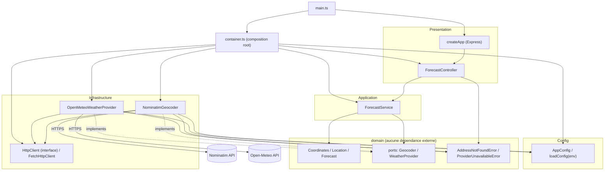

# TP Gestion des dépendances — API de prévisions météo par adresse

API HTTP qui, à partir d'une adresse, géocode le lieu (Nominatim) puis récupère les
prévisions de rayonnement solaire horaire (Open-Meteo).

`GET /forecast?address=<adresse>` :

```json
{
  "address": "Alès",
  "latitude": 44.13,
  "longitude": 4.08,
  "hourly": { "time": ["2024-01-01T00:00", "..."], "shortwave_radiation": [0, 94, "..."] }
}
```

Ce dépôt est un TP d'architecture logicielle : l'objectif pédagogique est la gestion
propre des dépendances (ports/adapters, injection de dépendances via IoC, composition
root unique), pas la fonctionnalité elle-même.

## Lancement

```bash
npm install
cp .env.example .env   # ajuster si besoin (voir tableau des variables ci-dessous)
npm run dev             # serveur de dev (tsx watch), ou :
npm run build && npm start
```

Le serveur écoute par défaut sur `http://localhost:3000`.

### Exemples de requêtes

```bash
curl "http://localhost:3000/forecast?address=Al%C3%A8s"
# 200 -> { "address": "Alès", "latitude": 44.12, "longitude": 4.08, "hourly": {...} }

curl "http://localhost:3000/forecast"
# 400 -> { "error": "Query parameter 'address' is required and must not be empty" }

curl "http://localhost:3000/forecast?address=xyzzy-adresse-inexistante"
# 404 -> { "error": "Address not found: xyzzy-adresse-inexistante" }

# Si Nominatim ou Open-Meteo est indisponible / timeout / répond un format invalide :
# 502 -> { "error": "The address geocoding or weather forecast provider is currently unavailable" }
```

### Scripts npm

| Script | Effet |
|---|---|
| `npm run dev` | Démarre le serveur en mode watch (`tsx`) |
| `npm run build` | Compile TypeScript vers `dist/` |
| `npm start` | Démarre le serveur compilé (`dist/main.js`) |
| `npm test` | Tests unitaires (`tests/unit`, aucun accès réseau) |
| `npm run test:e2e` | Tests bout-en-bout (`tests/e2e`, supertest + msw, aucun accès réseau) |
| `npm run test:smoke` | Test optionnel contre les vraies API (désactivé sauf `RUN_SMOKE_TESTS=1`) |
| `npm run lint` | ESLint |
| `npm run audit` | `npm audit` |

## Architecture en couches

Les dépendances de code ne pointent que vers l'intérieur : `presentation` et
`infrastructure` dépendent de `application`/`domain`, jamais l'inverse. `domain` ne
dépend de rien (pas d'Express, pas de lib HTTP). `container.ts` est le **seul**
endroit qui connaît les implémentations concrètes (Nominatim, Open-Meteo, Express,
fetch).



**Ajouter un nouveau fournisseur** (ex. un autre géocodeur) = une nouvelle classe
`implements Geocoder` dans `infrastructure/`, + une ligne de binding dans
`container.ts`. Zéro modification de `domain/` ou `application/`.

**Point d'extension documenté (non implémenté)** : pas de cache, retry ou circuit
breaker (hors scope, sur-ingénierie pour ce TP). Le point d'extension naturel est un
**décorateur de `Geocoder`** (ex. `CachingGeocoder implements Geocoder` qui enveloppe
`NominatimGeocoder` et court-circuite les adresses déjà résolues) branché d'une seule
ligne dans `container.ts` — cohérent avec le rate limit Nominatim (~1 req/s).

## Tableau d'inventaire des dépendances

| Dépendance | Interne / Externe | Directe / Transitive | Explicite / Implicite | Couplage | Risque |
|---|---|---|---|---|---|
| `express` | Externe | Directe | Explicite | Faible (isolé dans `presentation/createApp.ts`) | Faible — mature, très utilisé |
| `inversify` | Externe | Directe | Explicite | Moyen (décorateurs `@injectable`/`@inject` dans application/infra/presentation) | Faible/Moyen — API stable mais structurante |
| `reflect-metadata` | Externe | Directe | Explicite (import à effet de bord) | Faible mais global (requis avant tout usage de décorateurs) | Faible |
| `typescript` | Externe | Directe (dev) | Explicite | Fort (compile-time, tout le repo) | Faible — outil mûr |
| `vitest` (+ `vite`, `esbuild`, `@vitest/mocker` transitifs) | Externe | Directe (vitest) / Transitive (vite, esbuild) | Explicite (vitest) / Implicite (transitifs) | Faible (tests uniquement) | **Moyen** — vulnérabilités connues dev-only, voir `npm audit` ci-dessous |
| `supertest` | Externe | Directe (dev) | Explicite | Faible (tests e2e uniquement) | Faible |
| `msw` | Externe | Directe (dev) | Explicite | Faible (tests uniquement) | Faible/Moyen — écosystème plus jeune que nock, mais seul à supporter `fetch` natif de façon stable (voir note ci-dessous) |
| `eslint` / `typescript-eslint` | Externe | Directe (dev) | Explicite | Faible | Faible |
| `tsx` | Externe | Directe (dev) | Explicite | Faible (dev server uniquement) | Faible |
| **API Nominatim** (`nominatim.openstreetmap.org`) | Externe (service, pas un paquet) | Directe (`NominatimGeocoder`) | Explicite dans le code, **implicite** dans son contrat (pas de SLA) | Fort — en tête de chaîne, bloquant pour toute la fonctionnalité | **Fort — SPOF** (voir section dédiée) |
| **API Open-Meteo** (`api.open-meteo.com`) | Externe (service) | Directe (`OpenMeteoWeatherProvider`) | Explicite dans le code, implicite dans son contrat | Moyen — isolé derrière un adapter, mais bloquant en aval | Moyen — gratuit, sans SLA formel, mais historiquement permissif |
| Variables d'environnement (`PORT`, `NOMINATIM_BASE_URL`, `OPEN_METEO_BASE_URL`, `NOMINATIM_USER_AGENT`, `HTTP_TIMEOUT_MS`) | Interne au process | Directe (lues uniquement dans `config/Config.ts`) | **Implicite** (rien ne force leur présence) | Faible (valeurs par défaut sûres) | Faible — documenté dans `.env.example` |
| User-Agent Nominatim | — (politique d'usage externe) | Directe | **Implicite** (pas une erreur HTTP formelle, juste une politique d'usage) | Faible techniquement, **fort en pratique** | Moyen — un User-Agent absent/générique peut faire bannir l'IP silencieusement |
| Format des réponses JSON externes (Nominatim, Open-Meteo) | — (contrat non versionné) | Directe | **Implicite** (pas de schéma/OpenAPI garanti) | Fort — tout le mapping anti-corruption en dépend | Moyen — mitigé : réponse malformée → `ProviderUnavailableError` (502) plutôt qu'un crash |
| Rate limit Nominatim (~1 req/s, usage policy) | — | Directe (appelée à chaque requête entrante) | **Implicite** (non enforced côté code) | Fort si trafic élevé | Fort — cf. SPOF |
| Node.js runtime (`fetch`/`AbortController` natifs, ESM) | Externe | Directe | Implicite (version LTS attendue) | Fort (toute l'app) | Faible |

## SPOF et dépendance la plus risquée

**SPOF : l'API Nominatim.** Elle est en tête de chaîne (`ForecastService` appelle
toujours `geocode()` avant `getHourlyForecast()`) : si Nominatim est indisponible,
lent, ou rate-limite l'appel, **aucune** prévision ne peut être produite, même si
Open-Meteo fonctionne parfaitement. C'est un service communautaire gratuit sans SLA
contractuel, avec une politique d'usage stricte (~1 req/s, User-Agent obligatoire) qui
peut se traduire par un bannissement d'IP silencieux en cas de non-respect.

**Stratégie envisagée (non implémentée, hors scope du TP)** :
- Isoler ce risque derrière le point d'extension déjà prévu (décorateur `Geocoder`) :
  un `CachingGeocoder` réduirait la pression sur Nominatim pour les adresses
  répétées, et un futur `RetryingGeocoder`/`FallbackGeocoder` (ex. bascule vers un
  second fournisseur de géocodage) absorberait les indisponibilités ponctuelles.
- Le `HttpTimeoutMs` configurable évite déjà qu'une requête bloquée ne bloque
  indéfiniment l'API — c'est le seul filet de sécurité actuellement en place.
- À plus long terme : contractualiser (self-host Nominatim, ou un fournisseur
  commercial avec SLA) si le volume de requêtes dépasse ce que le service public
  tolère.

Open-Meteo est la deuxième dépendance la plus risquée (même schéma de risque, mais
moins critique : historiquement plus permissif, pas de contrainte 1 req/s documentée).

## npm audit

```
$ npm audit
# npm audit report

@vitest/mocker  <=4.1.10
Severity: moderate
Vitest: Path Traversal / Arbitrary File Read via @vitest/mocker Redirect Mock - https://github.com/advisories/GHSA-82fw-gwwq-j7x9
Depends on vulnerable versions of vite
fix available via `npm audit fix --force`
Will install vitest@5.0.1, which is a breaking change
node_modules/@vitest/mocker
  vitest  <=4.1.10
  Depends on vulnerable versions of @vitest/mocker
  Depends on vulnerable versions of vite
  Depends on vulnerable versions of vite-node
  node_modules/vitest

esbuild  <=0.24.2
Severity: moderate
esbuild enables any website to send any requests to the development server and read the response - https://github.com/advisories/GHSA-67mh-4wv8-2f99
fix available via `npm audit fix --force`
Will install vitest@5.0.1, which is a breaking change
node_modules/vite/node_modules/esbuild
  vite  <=6.4.2
  Depends on vulnerable versions of esbuild
  node_modules/vite
    vite-node  <=2.2.0-beta.2
    Depends on vulnerable versions of vite
    node_modules/vite-node

5 vulnerabilities (3 moderate, 1 high, 1 critical)
```

**Analyse** : les 5 vulnérabilités restantes sont toutes internes à la chaîne
`vitest → vite → esbuild`, un outil de **développement/test uniquement**, jamais
présent dans `dist/` ni dans les dépendances de production (`express`, `inversify`,
`reflect-metadata`). Le risque décrit (un site web qui interroge le serveur de dev
esbuild) ne s'applique pas ici puisqu'aucun serveur de dev esbuild n'est exposé — la
CI/exécution des tests ne l'expose jamais publiquement. Le correctif nécessite un
passage à `vitest@5` (changement majeur, non trivial sur ce TP) ; accepté comme
risque résiduel documenté plutôt que traité en urgence.

## npm ls --depth=0

```
$ npm ls --depth=0
tp-gestion-dependances@1.0.0
+-- @eslint/js@9.39.5
+-- @types/express@4.17.21
+-- @types/node@22.10.10
+-- @types/supertest@6.0.2
+-- eslint@9.39.5
+-- express@4.22.3
+-- inversify@6.2.2
+-- msw@2.15.0
+-- reflect-metadata@0.2.2
+-- supertest@7.1.3
+-- tsx@4.23.13
+-- typescript-eslint@8.21.0
+-- typescript@5.7.3
`-- vitest@2.1.9
```

## Notes techniques

- **Pourquoi `msw` plutôt que `nock`** (le sujet autorisait les deux) : l'adapter
  `FetchHttpClient` utilise le `fetch` natif de Node (basé sur `undici`). `nock`
  n'intercepte que le module `http` historique — son support de `fetch`/`undici` est
  encore expérimental (`nock@beta` uniquement), ce qui a été vérifié empiriquement
  avant de choisir `msw`, qui l'intercepte nativement et de façon stable.
- **Timeout HTTP** : `FetchHttpClient` utilise `AbortController` ; le délai est
  configurable via `HTTP_TIMEOUT_MS` (config, jamais lu ailleurs que dans
  `config/Config.ts`).
- Aucun `new` de service/adapter en dehors de `container.ts` (hors tests, où des
  fakes écrits à la main implémentent directement les ports du domaine).
