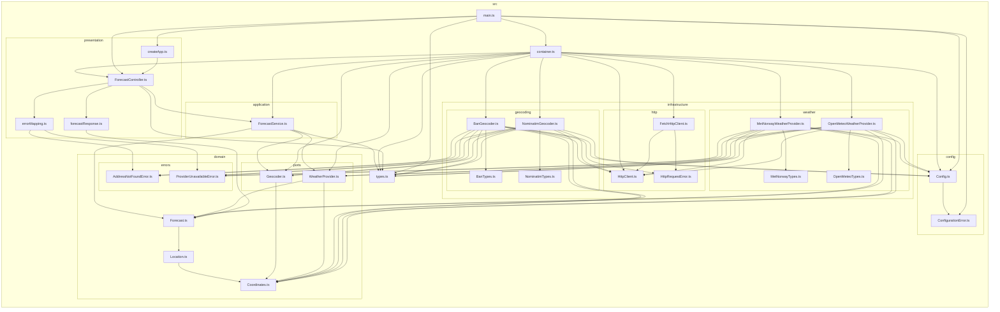

# TP Gestion des dépendances — API de prévisions météo par adresse

API HTTP qui, à partir d'une adresse, géocode le lieu (Nominatim) puis récupère les
prévisions de rayonnement solaire horaire (Open-Meteo).

`GET /forecast?address=<adresse>` :

```json
{
  "address": "Alès",
  "latitude": 44.13,
  "longitude": 4.08,
  "timezone": "Europe/Paris",
  "hourly": [
    { "time": "2024-01-01T00:00", "shortwaveRadiation": { "value": 0, "unit": "W/m²" } },
    { "time": "2024-01-01T01:00", "shortwaveRadiation": { "value": 94, "unit": "W/m²" } }
  ]
}
```

> Forme mise à jour au TP2 : `hourly` est une liste de points horodatés, chaque mesure
> étant optionnelle. Un fournisseur qui ne mesure pas le rayonnement (ex. MET Norway)
> renvoie simplement des points sans la clé `shortwaveRadiation`, avec d'autres clés
> à la place (`temperature`, `windSpeed`). Voir la section [TP2](#tp2--changement-dapi).

Ce dépôt est un TP d'architecture logicielle : l'objectif pédagogique est la gestion
propre des dépendances (ports/adapters, injection de dépendances via IoC, composition
root unique), pas la fonctionnalité elle-même.

## Lancement

```bash
npm install
cp .env.example .env   # ajuster si besoin (voir tableau des variables ci-dessous)
npm run dev             # serveur de dev (tsx watch), ou :
npm run build && npm start
```

Le serveur écoute par défaut sur `http://localhost:3000`.

### Exemples de requêtes

> **Sous Windows PowerShell**, `curl` est un alias vers `Invoke-WebRequest`. Deux
> pièges : (1) il lève une exception sur les réponses non-2xx (400/404/502) et
> demande confirmation avant de parser le corps ; (2) même sur un 200, il affiche un
> **résumé tronqué** (`StatusCode`, `Content` coupé, ...) au lieu du corps JSON — les
> données sont bien là, juste pas affichées en entier. Ce n'est pas un bug de l'API.
> Pour voir la réponse complète, utilisez `curl.exe` (le vrai binaire curl) ou
> `Invoke-RestMethod` (parse directement le JSON) :
> ```powershell
> curl.exe "http://localhost:3000/forecast?address=Lyon"
> # ou
> Invoke-RestMethod "http://localhost:3000/forecast?address=Lyon" | ConvertTo-Json -Depth 5
> ```
> Bash (WSL, Git Bash, macOS, Linux) n'est pas concerné par ces deux pièges.

```bash
curl "http://localhost:3000/forecast?address=Al%C3%A8s"
# 200 -> { "address": "Alès", "latitude": 44.12, "longitude": 4.08, "timezone": "Europe/Paris",
#          "hourly": [ { "time": "...", "shortwaveRadiation": { "value": 0, "unit": "W/m²" } }, ... ] }

curl "http://localhost:3000/forecast"
# 400 -> { "error": "Query parameter 'address' is required and must not be empty" }

curl "http://localhost:3000/forecast?address=xyzzy-adresse-inexistante"
# 404 -> { "error": "Address not found: xyzzy-adresse-inexistante" }

# Si Nominatim ou Open-Meteo est indisponible / timeout / répond un format invalide :
# 502 -> { "error": "The address geocoding or weather forecast provider is currently unavailable" }
```

```powershell
# Equivalent PowerShell (curl.exe = vrai binaire curl, contourne l'alias Invoke-WebRequest)
curl.exe "http://localhost:3000/forecast?address=Al%C3%A8s"
curl.exe "http://localhost:3000/forecast"
curl.exe "http://localhost:3000/forecast?address=xyzzy-adresse-inexistante"
```

### Scripts npm

| Script | Effet |
|---|---|
| `npm run dev` | Démarre le serveur en mode watch (`tsx`) |
| `npm run build` | Compile TypeScript vers `dist/` |
| `npm start` | Démarre le serveur compilé (`dist/main.js`) |
| `npm test` | Tests unitaires (`tests/unit`, aucun accès réseau) |
| `npm run test:contracts` | Tests de contrat par port (`tests/contracts`, un jeu d'assertions par fournisseur) |
| `npm run test:e2e` | Tests bout-en-bout (`tests/e2e`, supertest + msw, aucun accès réseau) |
| `npm run test:smoke` | Test optionnel contre les vraies API (désactivé sauf `RUN_SMOKE_TESTS=1`) |
| `npm run lint` | ESLint |
| `npm run arch` | Vérifie les règles de dépendances entre couches (`dependency-cruiser`) |
| `npm run arch:graph` | Régénère `docs/dependency-graph.mmd` (graphe Mermaid du README) |
| `npm run audit` | `npm audit` |
| `npm run verify` | Enchaîne lint + build + arch + tous les tests (hors smoke) |

## Architecture en couches

Les dépendances de code ne pointent que vers l'intérieur : `presentation` et
`infrastructure` dépendent de `application`/`domain`, jamais l'inverse. `domain` ne
dépend de rien (pas d'Express, pas de lib HTTP). `container.ts` est le **seul**
endroit qui connaît les implémentations concrètes (Nominatim, Open-Meteo, Express,
fetch).

> Graphe **généré automatiquement** par `dependency-cruiser` (`npm run arch:graph`),
> à partir du code réel — pas dessiné à la main. Il ne peut donc pas dériver de
> l'implémentation : s'il change, c'est que le code a changé. Voir la section
> [Étape 5 — dependency-cruiser](#étape-5--verification-automatique-des-frontières-dependency-cruiser)
> pour la vérification des règles qui le rendent fiable.



On y lit directement les invariants vérifiés par `dependency-cruiser` : `domain/`
(sous-graphe 3) n'a aucune flèche sortante vers autre chose que lui-même ;
`application/` (`ForecastService.ts`) ne pointe que vers `domain/` et `types.ts` ;
`presentation/` ne pointe jamais vers `infrastructure/` ; et `container.ts` (E) est
le seul nœud hors `infrastructure/` à pointer vers un adapter concret
(`BanGeocoder`, `NominatimGeocoder`, `MetNorwayWeatherProvider`,
`OpenMeteoWeatherProvider`, `FetchHttpClient`).

**Ajouter un nouveau fournisseur** (ex. un autre géocodeur) = une nouvelle classe
`implements Geocoder` dans `infrastructure/`, + une ligne de binding dans
`container.ts`. Zéro modification de `domain/` ou `application/`.

**Point d'extension documenté (non implémenté)** : pas de cache, retry ou circuit
breaker (hors scope, sur-ingénierie pour ce TP). Le point d'extension naturel est un
**décorateur de `Geocoder`** (ex. `CachingGeocoder implements Geocoder` qui enveloppe
`NominatimGeocoder` et court-circuite les adresses déjà résolues) branché d'une seule
ligne dans `container.ts` — cohérent avec le rate limit Nominatim (~1 req/s).

## Tableau d'inventaire des dépendances

| Dépendance | Interne / Externe | Directe / Transitive | Explicite / Implicite | Couplage | Risque |
|---|---|---|---|---|---|
| `express` | Externe | Directe | Explicite | Faible (isolé dans `presentation/createApp.ts`) | Faible — mature, très utilisé |
| `inversify` | Externe | Directe | Explicite | Moyen (décorateurs `@injectable`/`@inject` dans application/infra/presentation) | Faible/Moyen — API stable mais structurante |
| `reflect-metadata` | Externe | Directe | Explicite (import à effet de bord) | Faible mais global (requis avant tout usage de décorateurs) | Faible |
| `typescript` | Externe | Directe (dev) | Explicite | Fort (compile-time, tout le repo) | Faible — outil mûr |
| `vitest` (+ `vite`, `esbuild`, `@vitest/mocker` transitifs) | Externe | Directe (vitest) / Transitive (vite, esbuild) | Explicite (vitest) / Implicite (transitifs) | Faible (tests uniquement) | **Moyen** — vulnérabilités connues dev-only, voir `npm audit` ci-dessous |
| `supertest` | Externe | Directe (dev) | Explicite | Faible (tests e2e uniquement) | Faible |
| `msw` | Externe | Directe (dev) | Explicite | Faible (tests uniquement) | Faible/Moyen — écosystème plus jeune que nock, mais seul à supporter `fetch` natif de façon stable (voir note ci-dessous) |
| `eslint` / `typescript-eslint` | Externe | Directe (dev) | Explicite | Faible | Faible |
| `tsx` | Externe | Directe (dev) | Explicite | Faible (dev server uniquement) | Faible |
| **API Nominatim** (`nominatim.openstreetmap.org`) | Externe (service, pas un paquet) | Directe (`NominatimGeocoder`) | Explicite dans le code, **implicite** dans son contrat (pas de SLA) | Fort — en tête de chaîne, bloquant pour toute la fonctionnalité | **Fort — SPOF** (voir section dédiée) |
| **API Open-Meteo** (`api.open-meteo.com`) | Externe (service) | Directe (`OpenMeteoWeatherProvider`) | Explicite dans le code, implicite dans son contrat | Moyen — isolé derrière un adapter, mais bloquant en aval | Moyen — gratuit, sans SLA formel, mais historiquement permissif |
| Variables d'environnement (`PORT`, `NOMINATIM_BASE_URL`, `OPEN_METEO_BASE_URL`, `NOMINATIM_USER_AGENT`, `HTTP_TIMEOUT_MS`, `OPEN_METEO_TIMEZONE`) | Interne au process | Directe (lues uniquement dans `config/Config.ts`) | **Implicite** (rien ne force leur présence) | Faible (valeurs par défaut sûres) | Faible — documenté dans `.env.example` |
| User-Agent Nominatim | — (politique d'usage externe) | Directe | **Implicite** (pas une erreur HTTP formelle, juste une politique d'usage) | Faible techniquement, **fort en pratique** | Moyen — un User-Agent absent/générique peut faire bannir l'IP silencieusement |
| Format des réponses JSON externes (Nominatim, Open-Meteo) | — (contrat non versionné) | Directe | **Implicite** (pas de schéma/OpenAPI garanti) | Fort — tout le mapping anti-corruption en dépend | Moyen — mitigé : réponse malformée → `ProviderUnavailableError` (502) plutôt qu'un crash |
| Rate limit Nominatim (~1 req/s, usage policy) | — | Directe (appelée à chaque requête entrante) | **Implicite** (non enforced côté code) | Fort si trafic élevé | Fort — cf. SPOF |
| Fuseau horaire / unités Open-Meteo (`timezone`, `hourly_units`) | — (contrat non versionné) | Directe (mappés dans `OpenMeteoWeatherProvider`, fuseau demandé via `OPEN_METEO_TIMEZONE`, défaut `"auto"`) | **Implicite** (Open-Meteo peut changer les libellés d'unité, ex. `"W/m²"`, sans préavis contractuel) | Moyen — consommé uniquement en presentation pour l'affichage, n'impacte pas la logique métier | Faible/Moyen — mitigé comme le reste du format JSON externe : absence de `timezone`/`hourly_units` → `ProviderUnavailableError` (502) plutôt qu'une valeur silencieusement fausse |
| Node.js runtime (`fetch`/`AbortController` natifs, ESM) | Externe | Directe | Implicite (version LTS attendue) | Fort (toute l'app) | Faible |

## SPOF et dépendance la plus risquée

**SPOF : l'API Nominatim.** Elle est en tête de chaîne (`ForecastService` appelle
toujours `geocode()` avant `getHourlyForecast()`) : si Nominatim est indisponible,
lent, ou rate-limite l'appel, **aucune** prévision ne peut être produite, même si
Open-Meteo fonctionne parfaitement. C'est un service communautaire gratuit sans SLA
contractuel, avec une politique d'usage stricte (~1 req/s, User-Agent obligatoire) qui
peut se traduire par un bannissement d'IP silencieux en cas de non-respect.

**Stratégie envisagée (non implémentée, hors scope du TP)** :
- Isoler ce risque derrière le point d'extension déjà prévu (décorateur `Geocoder`) :
  un `CachingGeocoder` réduirait la pression sur Nominatim pour les adresses
  répétées, et un futur `RetryingGeocoder`/`FallbackGeocoder` (ex. bascule vers un
  second fournisseur de géocodage) absorberait les indisponibilités ponctuelles.
- Le `HttpTimeoutMs` configurable évite déjà qu'une requête bloquée ne bloque
  indéfiniment l'API — c'est le seul filet de sécurité actuellement en place.
- À plus long terme : contractualiser (self-host Nominatim, ou un fournisseur
  commercial avec SLA) si le volume de requêtes dépasse ce que le service public
  tolère.

Open-Meteo est la deuxième dépendance la plus risquée (même schéma de risque, mais
moins critique : historiquement plus permissif, pas de contrainte 1 req/s documentée).

## npm audit

```
$ npm audit
# npm audit report

@vitest/mocker  <=4.1.10
Severity: moderate
Vitest: Path Traversal / Arbitrary File Read via @vitest/mocker Redirect Mock - https://github.com/advisories/GHSA-82fw-gwwq-j7x9
Depends on vulnerable versions of vite
fix available via `npm audit fix --force`
Will install vitest@5.0.1, which is a breaking change
node_modules/@vitest/mocker
  vitest  <=4.1.10
  Depends on vulnerable versions of @vitest/mocker
  Depends on vulnerable versions of vite
  Depends on vulnerable versions of vite-node
  node_modules/vitest

esbuild  <=0.24.2
Severity: moderate
esbuild enables any website to send any requests to the development server and read the response - https://github.com/advisories/GHSA-67mh-4wv8-2f99
fix available via `npm audit fix --force`
Will install vitest@5.0.1, which is a breaking change
node_modules/vite/node_modules/esbuild
  vite  <=6.4.2
  Depends on vulnerable versions of esbuild
  node_modules/vite
    vite-node  <=2.2.0-beta.2
    Depends on vulnerable versions of vite
    node_modules/vite-node

5 vulnerabilities (3 moderate, 1 high, 1 critical)
```

**Analyse** : les 5 vulnérabilités restantes sont toutes internes à la chaîne
`vitest → vite → esbuild`, un outil de **développement/test uniquement**, jamais
présent dans `dist/` ni dans les dépendances de production (`express`, `inversify`,
`reflect-metadata`). Le risque décrit (un site web qui interroge le serveur de dev
esbuild) ne s'applique pas ici puisqu'aucun serveur de dev esbuild n'est exposé — la
CI/exécution des tests ne l'expose jamais publiquement. Le correctif nécessite un
passage à `vitest@5` (changement majeur, non trivial sur ce TP) ; accepté comme
risque résiduel documenté plutôt que traité en urgence.

## npm ls --depth=0

```
$ npm ls --depth=0
tp-gestion-dependances@1.0.0
+-- @eslint/js@9.39.5
+-- @types/express@4.17.21
+-- @types/node@22.10.10
+-- @types/supertest@6.0.2
+-- eslint@9.39.5
+-- express@4.22.3
+-- inversify@6.2.2
+-- msw@2.15.0
+-- reflect-metadata@0.2.2
+-- supertest@7.1.3
+-- tsx@4.23.13
+-- typescript-eslint@8.21.0
+-- typescript@5.7.3
`-- vitest@2.1.9
```

## Notes techniques

- **Pourquoi `msw` plutôt que `nock`** (le sujet autorisait les deux) : l'adapter
  `FetchHttpClient` utilise le `fetch` natif de Node (basé sur `undici`). `nock`
  n'intercepte que le module `http` historique — son support de `fetch`/`undici` est
  encore expérimental (`nock@beta` uniquement), ce qui a été vérifié empiriquement
  avant de choisir `msw`, qui l'intercepte nativement et de façon stable.
- **Timeout HTTP** : `FetchHttpClient` utilise `AbortController` ; le délai est
  configurable via `HTTP_TIMEOUT_MS` (config, jamais lu ailleurs que dans
  `config/Config.ts`).
- Aucun `new` de service/adapter en dehors de `container.ts` (hors tests, où des
  fakes écrits à la main implémentent directement les ports du domaine).

## TP2 — Changement d'API

Le TP1 a posé l'architecture (ports/adapters, IoC/DI). Le TP2 met cette architecture à
l'épreuve : peut-on ajouter un **deuxième géocodeur** et un **deuxième fournisseur
météo**, sélectionnables par configuration, en modifiant le moins de code existant
possible ? L'état final du TP1 est figé par le tag Git `tp1` ; tous les commits du TP2
sont préfixés `TP2:`.

**Objectif** : démontrer que le coût d'ajout d'un fournisseur est bien celui annoncé au
TP1 ("une classe + une ligne dans `container.ts`"), ou documenter honnêtement où cette
promesse ne tient pas.

**Nouveaux fournisseurs à intégrer** :
- Géocodage : [BAN](https://api-adresse.data.gouv.fr/) (Base Adresse Nationale,
  France uniquement), à côté de Nominatim.
- Météo : [MET Norway](https://api.met.no/) (locationforecast/2.0/compact), à côté
  d'Open-Meteo — MET Norway ne fournit pas le rayonnement solaire, ce qui oblige à
  vérifier que le modèle de domaine ne suppose pas qu'un champ météo est toujours
  présent.

**Plan** :
1. Audit : repérer les formats/noms propres à Nominatim ou Open-Meteo qui auraient
   fui hors de `infrastructure/` (validé avant tout code).
2. Nouveaux adapters `BanGeocoder` et `MetNorwayWeatherProvider`, derrière les ports
   existants du domaine.
3. Sélection du fournisseur par variables d'environnement, résolue uniquement dans
   `container.ts`.
4. Tests de contrat : un seul jeu d'assertions par port, exécuté contre chaque
   implémentation (Nominatim/BAN, Open-Meteo/MET Norway).
5. Vérification automatisée des règles de dépendances (`dependency-cruiser`) pour
   garantir qu'aucun DTO d'adapter ne fuit hors de son fichier.
6. Bilan chiffré (`git diff --stat tp1..HEAD`) : fichiers ajoutés vs modifiés, et
   raison de chaque modification.

Le détail de chaque étape est documenté au fur et à mesure ci-dessous, au fil des
commits `TP2:`.

### Modèle de domaine neutre (étape 1-2)

L'audit a montré que le domaine du TP1 portait en fait le format Open-Meteo
(`shortwaveRadiation` obligatoire, tableaux parallèles `time[]`/`valeurs[]` + objet
`hourly_units` séparé — calqué sur la structure JSON exacte d'Open-Meteo). Impossible
pour MET Norway, qui ne fournit pas le rayonnement solaire.

Nouveau modèle : une série de **points horodatés**, chaque mesure étant **optionnelle**
et portant sa propre unité, au lieu de tableaux parallèles à côté d'un objet d'unités :

```ts
interface WeatherMeasurement { value: number; unit: string; }
interface HourlyPoint {
  time: string;
  temperature?: WeatherMeasurement;
  shortwaveRadiation?: WeatherMeasurement;
  windSpeed?: WeatherMeasurement;
}
```

Chaque provider ne remplit que ce qu'il sait mesurer (Open-Meteo → `shortwaveRadiation`
uniquement ; MET Norway → `temperature`/`windSpeed` uniquement, jamais
`shortwaveRadiation`). La réponse HTTP est maintenant un mapping direct de ce modèle
(plus aucune trace de `shortwave_radiation`/`hourly_units` dans `presentation/`).

### ADR — Erreur BAN pour une requête trop courte

**Contexte** : la BAN répond HTTP 400 (pas un tableau vide) quand la requête fait moins
de 3 caractères.

**Décision** : `BanGeocoder` traduit ce 400 en `AddressNotFoundError`, la même erreur
domaine qu'un résultat vide — pas de nouveau type d'erreur dédié à cette contrainte.

**Justification** : "la requête est trop courte pour être géocodée" reste, du point de
vue de l'appelant, un cas de "cette adresse n'a pas pu être résolue". Créer une erreur
domaine spécifique à une contrainte syntaxique propre à *un seul* fournisseur (Nominatim
n'a pas cette limite) aurait été une fuite d'abstraction à l'envers : le domaine se
mettrait à connaître un détail d'implémentation d'un adapter particulier. C'est un choix
assumé, pas un oubli — `ProviderUnavailableError` reste réservé aux vraies pannes
(timeout, HTTP 5xx, réponse malformée).

### ADR — Série météo vide traitée comme une panne, pas comme une prévision vide

**Contexte** : que faire quand un fournisseur météo répond avec succès (HTTP 200) mais
une série temporelle structurellement vide (`hourly.time: []`) ?

**Décision** : `ProviderUnavailableError`, pas un `WeatherForecast` avec `hourly: []`.
Comportement identique pour `OpenMeteoWeatherProvider` et `MetNorwayWeatherProvider`.

**Justification** : pour ce domaine (prévisions horaires sur plusieurs jours, couverture
mondiale des deux API), une série vide pour des coordonnées valides n'est jamais un état
métier légitime — elle signale une anomalie (coordonnées hors couverture, dégradation du
provider). Traiter ce cas comme une erreur plutôt qu'une prévision vide garde un
invariant simple pour toute la chaîne en aval (`Forecast` réussi ⇒ toujours exploitable)
et évite une incohérence entre les deux implémentations du port `WeatherProvider`.
Compromis assumé : si un provider avait un jour une raison légitime de renvoyer "aucune
donnée pour cette zone" sans panne, cette distinction serait perdue — non rencontré en
pratique sur ces deux API.

### Étape 5 — vérification automatique des frontières (dependency-cruiser)

Les étapes précédentes vérifiaient l'absence de fuite "à la lecture" (audit manuel,
tests de contrat). L'étape 5 rend cette garantie **vérifiable automatiquement** :
`dependency-cruiser` (`.dependency-cruiser.cjs`) analyse le graphe d'imports réel de
`src/` et `tests/` et échoue si une des règles suivantes est violée :

| Règle | Ce qu'elle empêche |
|---|---|
| `domain-purity` | `domain/` important autre chose que `domain/` (même une lib npm) |
| `application-purity` | `application/` important `infrastructure/`/`presentation/` ou une lib HTTP |
| `presentation-purity` | `presentation/` important `infrastructure/` directement |
| `no-concrete-adapter-outside-container` | N'importe quel fichier de `src/` (hors `infrastructure/` et `container.ts`) qui importerait un adapter concret (`NominatimGeocoder`, `BanGeocoder`, `OpenMeteoWeatherProvider`, `MetNorwayWeatherProvider`, `FetchHttpClient`) |
| `nominatim-dto-private`, `ban-dto-private`, `open-meteo-dto-private`, `met-norway-dto-private` | N'importe quel fichier (y compris les tests de contrat) qui importerait le DTO privé d'un adapter autre que le sien |

`npm run arch` lance la vérification (`src` + `tests`, pour que la règle sur les DTO
couvre aussi les tests de contrat) ; `npm run arch:graph` régénère le graphe Mermaid
ci-dessus. Premier passage sur le code existant : **0 violation** — confirmé aussi en
vérifiant que les règles mordent bien (import volontairement fautif ajouté puis retiré,
voir historique de commit de cette étape).
